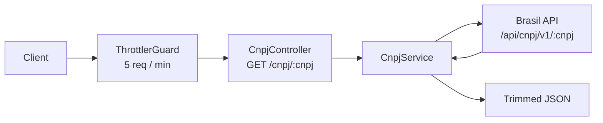

# BuscaCNPJ

A small NestJS API that looks up Brazilian companies by CNPJ. Send a CNPJ, get back the company's registration data, address, contacts and partners in a trimmed-down JSON.

The data comes from [Brasil API](https://brasilapi.com.br/). This API sits in front of it, keeps only the fields a client actually needs, and rate limits callers. The web frontend lives in [buscacnpj-frontend](https://github.com/gustavokurtz/buscacnpj-frontend).

## How it works



1. A global `ThrottlerGuard` checks the caller against the rate limit.
2. `CnpjController` passes the CNPJ from the URL to `CnpjService`.
3. `CnpjService` calls `https://brasilapi.com.br/api/cnpj/v1/{cnpj}` through `@nestjs/axios`.
4. The response is mapped to `CnpjResponseDto`: 24 fields out of Brasil API's payload. The partners list (`qsa`) is reduced to each partner's name.

There is no database and no cache. Every request goes to Brasil API.

## API

### `GET /cnpj/:cnpj`

Pass the CNPJ as 14 digits, without punctuation. The value is forwarded to Brasil API as is.

```bash
curl http://localhost:3000/cnpj/00000000000191
```

Example response (trimmed, values illustrative):

```json
{
  "cnpj": "00000000000191",
  "razao_social": "BANCO DO BRASIL SA",
  "nome_fantasia": "DIRECAO GERAL",
  "porte": "DEMAIS",
  "descricao_porte": "DEMAIS",
  "codigo_porte": 5,
  "capital_social": 120000000000,
  "cnae_fiscal": 6422100,
  "opcao_pelo_mei": null,
  "logradouro": "...",
  "numero": "...",
  "complemento": "...",
  "bairro": "...",
  "municipio": "BRASILIA",
  "codigo_municipio": 9701,
  "uf": "DF",
  "cep": "...",
  "pais": null,
  "codigo_pais": null,
  "email": null,
  "ddd_telefone_1": "...",
  "ddd_telefone_2": "",
  "ddd_fax": "",
  "qsa": [
    { "nome_socio": "..." }
  ]
}
```

The full field list and types are in [`src/cnpj/dto/CnpjResponseDto.ts`](src/cnpj/dto/CnpjResponseDto.ts).

Errors: any failure from Brasil API (invalid CNPJ, not found, upstream down) is rethrown as a plain `Error`, so the client gets a generic `500 Internal Server Error`.

### `GET /health`

Returns `{ "status": "ok" }`.

## Rate limiting

`@nestjs/throttler` is registered globally in `AppModule`:

- **5 requests per 60 seconds** per client (`ttl: 60000`, `limit: 5`)
- Applies to every route, `/health` included
- Over the limit, the API answers `429 Too Many Requests`

The limit is kept in memory, so it resets on restart and is not shared between instances.

CORS is enabled for all origins (`NestFactory.create(AppModule, { cors: true })`) so the frontend can call it from the browser.

## Stack

| | |
| --- | --- |
| Framework | NestJS 11 · TypeScript · Express |
| HTTP client | @nestjs/axios · RxJS |
| Rate limiting | @nestjs/throttler 6 |
| Data source | Brasil API |
| Tooling | Jest · ESLint · Prettier · SWC |
| Deploy | Dockerfile (Node 20.18) · `fly.toml` for Fly.io |

## Run it locally

Requirements: Node.js 20+ and npm.

```bash
git clone https://github.com/gustavokurtz/buscacnpj.git
cd buscacnpj
npm install
npm run start:dev
```

The API listens on `PORT` if set, otherwise on `3000`. No other environment variables or API keys are needed.

Other scripts:

```bash
npm run build        # compile to dist/
npm run start:prod   # run the compiled build
npm run lint
npm run format
```

With Docker:

```bash
docker build -t buscacnpj .
docker run -p 3000:3000 buscacnpj
```

## Tests

```bash
npm run test       # unit tests (*.spec.ts under src/)
npm run test:e2e   # e2e tests (test/*.e2e-spec.ts)
```

There are no unit tests yet. The only e2e test is the NestJS scaffold one: it expects `GET /` to return `Hello World!`, a route that no longer exists, so it fails as written.

## Frontend

The web UI is a Next.js app in a separate repo: [gustavokurtz/buscacnpj-frontend](https://github.com/gustavokurtz/buscacnpj-frontend).
